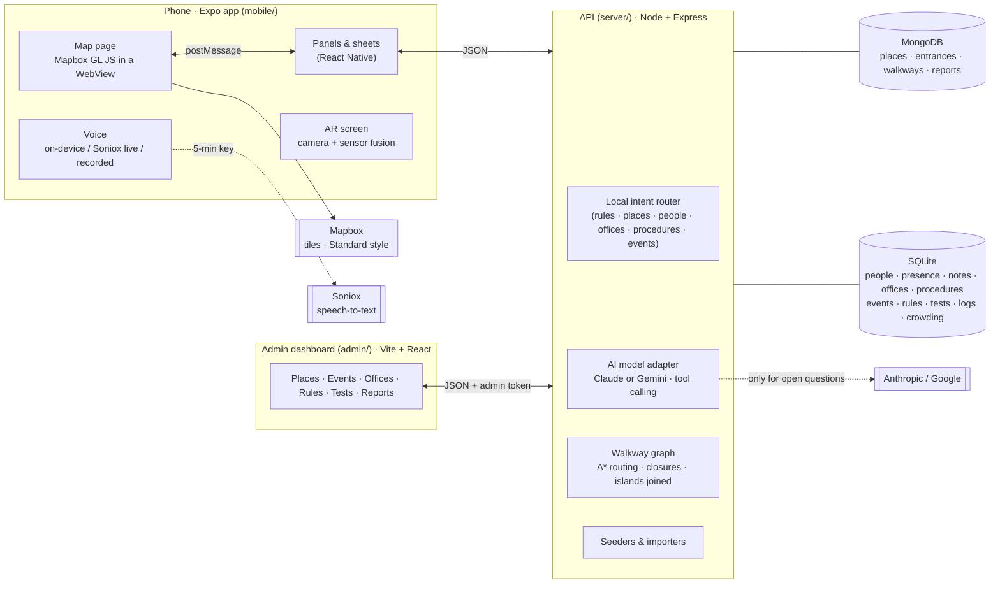
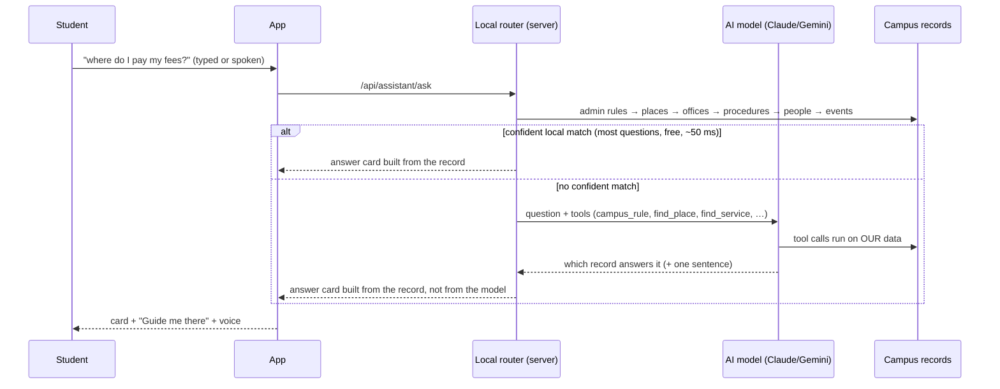
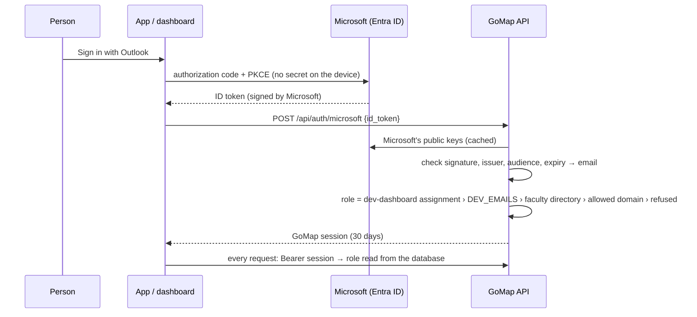

# GoMap

The campus map feature for **GoCampus**, Al Akhawayn University (Ifrane). It answers four questions:
*where is this place*, *is this person in their office*, *where do I go to get this done*, and *what is on today*.
It looks like the GoCampus app (dark green land, plum/navy buildings, white category chips, white-ringed pins) and adds
scenes, lit buildings, events, an assistant you can talk to, and AR walking arrows.

**Status:** working prototype on branch `yara-redesign`. Building numbers, positions, footpaths and roads come from real
map data. Categories, entrances, opening hours and procedures stay **unverified** until the campus office confirms them,
and the app says so wherever it shows them.

- Keys, databases, builds and the AI model: **[setup_guide.md](setup_guide.md)**
- What changed in this round, item by item: **[TODO.md](TODO.md)**

---

## 1. Architecture at a glance



| Folder | What it is |
| --- | --- |
| `server/` | Express API: routing graph, assistant, admin endpoints, seeders, geometry importers |
| `mobile/` | Expo app (runs in Expo Go; a dev build adds on-device speech). One persistent map under every panel |
| `admin/` | Vite + React: the admin dashboard (`index.html`) and the dev dashboard for roles (`dev.html`) |
| `data/` | Faculty directory JSON, imported campus geometry (`data/campus/`), satellite traces, hand-drawn fallbacks |
| `e2e/` | End-to-end tests: the real apps in a real browser, with a fake Microsoft sign-in, fake camera and sensors |

### How a question is answered



The model **chooses**, the server **states**. A building number, room, phone, hour or step always comes from a record,
so a model can never invent one, and switching models does not change any fact the app tells a student.

---

## 2. The choices, and why

### Map: Mapbox GL JS (Standard style) inside a WebView

| Option | Why not / why |
| --- | --- |
| `@rnmapbox/maps` (native) | Needs a dev build; the team tests in Expo Go. No benefit for a ~1 km² campus |
| Google Maps | No 3D building lighting, no configurable scenes, weaker footpath data in Ifrane |
| **Mapbox GL JS in a WebView** ✔ | Runs in Expo Go *and* on the web build; Standard style gives light presets (dusk/night = the GoCampus look), 3D buildings, emissive "lit" buildings and worldview `MA` (Moroccan borders) |

The map page (`mobile/src/map/mapHtml.ts`) is plain ES5 in a string, driven by JSON messages (`MapCommand`). It never
reloads: satellite is a photo layer inside the same style, scenes change the light preset in place, filters cross-fade
pins in place. **The camera is locked to Al Akhawayn** (`campusOutline.ts`: convex hull of every building + 90 m, max
bounds, min zoom 15.2); outside the outline is dimmed, in the app and in every admin map.

**Scenes:** *GoCampus* (default — dusk light by day, night light after dark, like the GoCampus app), *Day*, *Evening*
(dusk + a golden DOM wash, because Android WebViews ignore CSS filters on WebGL canvases — that is why the old evening
scene "did nothing"), *Dark* (open buildings glow). Satellite always stays in daylight and drops 3D buildings.

### Data: MongoDB for geometry, SQLite for everything else

| Store | Holds | Why |
| --- | --- | --- |
| **MongoDB** | places, entrances, walkways, report pins | GeoJSON + `2dsphere` indexes: "nearest place to this pin" and "reports within 20 m" are one query each. In-memory when `MONGODB_URI` is empty, so the project runs with zero setup |
| **SQLite** (`node:sqlite`) | people, presence + its log, door notes, offices, issue routing, procedures, **events, assistant rules & tests, users and their roles**, demo accounts, crowding, assistant cache/log | Built into Node, no server, one file. Declared types, ISO-8601 strings, JSON in TEXT, no AUTOINCREMENT → moves to Postgres unchanged |
| Postgres | everything in SQLite | When GoMap outgrows one server: the schema is already Postgres-safe |

### Routing: our own graph, not a directions API

Mapbox/Google directions do not know campus footpaths, stairs, closures reported by students, or estimated doors. The
graph (`server/src/routing/graph.ts`) is built at boot from walkways: T-junction snapping, crossing splits, 3 m vertex
merge, then **island joining** — every path piece that touches nothing is linked to the main network by its closest
short connector (≤ 80 m), and anything still cut off ends with a straight "last stretch" flagged *approximate*. That is
the fix for "no path to Building 14": its door sat on a 3-node path island 9 m from the main network. A test now routes
from the plaza to **every** place on campus. A* with costs per mode (walk prefers paths over roads; step-free refuses
stairs; drive refuses footpaths), and closures confirmed in the admin block edges within their radius instantly.

### Assistant: local first, AI model second, admin rules above both

1. **Admin rules** — answers the admin writes word for word (EN/FR/AR), with optional directions, office card or
   procedure steps. They win every tie. One example ships (Emergency → Security 24/7, a number already in the data).
2. **Local router** (`router.ts`, Fuse.js + phrase matching) over places, people, offices, issue routing, procedures and
   events. Handles Darija/French/Arabic number words, "8 b" → "8B", Arabic digits. Free and ~50 ms.
3. **AI model** only for what is left, through tools that run on our records. Provider adapter (`assistant/llm.ts`):
   - **Claude** (`claude-opus-5-5` by default, official `@anthropic-ai/sdk`) when `ANTHROPIC_API_KEY` is set: most
     reliable tool choice on mixed-language questions, prompt-cached system prompt, effort `low` (this is routing, not
     reasoning), server-side refusal fallbacks on.
   - **Gemini** otherwise — the current setup. Measured on the project's free-tier key with `npm run assistant:eval`:
     `gemini-3.5-flash-lite` got every question it answered right and was fastest; the bigger models have no free
     quota. The client retries short rate limits and falls back along `GEMINI_FALLBACK_MODELS` instead of failing.
     Gemini is also always the voice-transcription fallback (Claude has no audio input).
4. **Tests** — 18 starter questions with the record they must land on, editable in Admin → Assistant → Tests and run
   in CI (`server/test/api.test.ts`), plus `npm run assistant:eval`: 16 indirect questions scored per model. Running
   them found and fixed five misroutes ("park my car" → *Careers*, "Harit Satt's office" → *Business Office*,
   "World Cup" → *ITS* via "password", "I would *love* to study in Spain" → a professor named Love, "start a student
   club" → *Student Center*).

### Sign-in and roles: Outlook, checked by our server, roles from the dev dashboard



| Choice | Why |
| --- | --- |
| Microsoft Entra ID (OpenID Connect) | AUI runs on Microsoft 365: every student and professor already has the account, with AUI's own password and MFA rules. GoMap never handles a password |
| Authorization code + PKCE, no client secret | The standard for phones and single-page apps: nothing secret ships in the app |
| The **server** verifies the ID token (signature against Microsoft's published keys, issuer, audience, expiry) | The apps could be tampered with; the API cannot be fooled by a hand-made token. Node's own crypto, no extra library |
| Our own short session, role looked up on every request | A role changed in the dev dashboard applies at the person's next tap, no sign-out. Losing a role (e.g. a student who was admin for a project) takes effect immediately |
| Automatic roles from the faculty directory | Professors get faculty rights and their office card on day one, with no list to maintain |
| Demo accounts stay until the dev dashboard turns them off | The team can keep testing every role before launch; one switch removes them |

**Dev dashboard** (`admin/dev.html`, developers only): assign roles by email (one at a time or a pasted list), see what
an email would get *before* assigning ("faculty, from the faculty directory" / "cannot sign in"), link faculty accounts
to their office card, choose the allowed domains and default role, turn demo accounts off, and read who changed what.
It refuses to let a developer remove or demote their own account, or the last developer.

### Voice: three engines, best available wins

On-device recognition (dev build) → **Soniox** live streaming with a 5-minute key minted by the server (the permanent
key never reaches the phone) → record-and-transcribe (Soniox async, else Gemini). Replies use the device voice.

### AR: sensor fusion over the camera, not ARKit/ARCore — on purpose

| Option | Verdict |
| --- | --- |
| **Camera + GPS + compass + gyro fusion** ✔ (current) | Runs in Expo Go on any phone, and in mobile browsers (the standard `deviceorientation` event, since expo-sensors gives no rotation on the web); arrows projected on the ground plane from a fused heading; honest about accuracy |
| ViroReact / ARCore Geospatial / ARKit geo-anchors | Real world-locked anchors, but needs a dev build, Google Cloud VPS coverage (sparse in Ifrane), and native code we could not test without devices on campus. The upgrade path, documented in the setup guide |
| `react-native-mapbox-ar-master` (the folder in this repo) | Mapbox's 2018 beta on `react-viro` (abandoned). It renders tabletop terrain from terrain-RGB tiles; no navigation, no anchors. Useful idea kept for later: sample terrain-RGB so arrows follow Ifrane's slopes |

What makes it intuitive now: one instruction in words at the top ("Turn left" / "in 20 m") with the next step under it;
green chevrons and a big arrow at your feet that always points the way; a coach that tells you to raise/lower the phone;
a buzz and **"Turn around"** when you face away from the route; a single quiet accuracy pill (tap → calibrate);
bottom bar like the GoCampus references (stop · time & distance left · arrival time · map); arrival card; voice
on/off in the banner. The decisions live in `mobile/src/ar/guidance.ts` (unit-tested), and the whole screen was run end
to end in a browser with a fake camera, a GPS fix and simulated sensors.

### Admin: map or calendar first, edit beside it

Every page opens on a campus map (GoCampus look, **Satellite** toggle, locked to campus) or a calendar. Places: click a
category chip → every place in it, select with click/Shift/Ctrl/Ctrl+A, **Delete key** or buttons, **Undo**. Draw a
building on the satellite photo (click corners, Enter to finish) or name one of the 27 unnamed outlines → it becomes a
3D building in the app with an estimated entrance. Events: two-week calendar + map. Assistant: try any question and see
exactly how it was found, write rules, run the test suite, turn unanswered questions into rules.

---

## 3. Run it

Requirements: Node 22.13+ (24 recommended), a [Mapbox public token](https://account.mapbox.com/access-tokens/) (`pk.…`).
An AI key is optional (see the setup guide).

```bash
# 1. API
cd server && npm ci
cp .env.example .env            # keys optional; empty MONGODB_URI = in-memory database
npm start                       # http://localhost:4000/api/health → {"ok":true}

# 2. Mobile (Expo Go, SDK 58)
cd mobile && npm ci
cp .env.example .env.local      # EXPO_PUBLIC_API_URL=http://YOUR_WIFI_IP:4000, EXPO_PUBLIC_MAPBOX_TOKEN=pk.…
npx expo start --clear --lan

# 3. Admin
cd admin && npm ci && npm run dev   # http://localhost:5173 · token = ADMIN_TOKEN (dev default: dev-admin-token)
```

Use your computer's Wi-Fi IPv4 (`ipconfig`) for a physical phone, `http://10.0.2.2:4000` for the Android emulator.
**Away from campus?** Your blue dot stays real; routes start from the main plaza and are labelled as a demo, and
*Simulate walk* moves along the route.

## 4. Campus geometry

Footpaths, roads, stairs, building labels and footprints come from **Mapbox Streets vector tiles** (`npm run geo:import`,
or `-- --osm` for OpenStreetMap, which must be used before a public release because Mapbox's terms limit storing tile
data). `data/campus/traced.geojson` adds paths and footprints traced from satellite imagery — the team's, plus 13
buildings traced on Esri World Imagery after comparing the whole campus against every footprint (OpenStreetMap adds
nothing on campus) — and the app extrudes them as 3D buildings because the basemap lacks them. `npm run graph:check` prints the network, the joined
islands (with coordinates to check on site) and any place without a walkable entrance.

**Known gaps:** no open source (Mapbox, OpenStreetMap) labels buildings 12, 13, 16, 20, 28 or 37, so the traced
outlines carry no number yet — give them one in Admin → Places → Outlines (only someone who knows the campus can say
which is which). Building 16 and 14
pins are estimated. Entrances are estimated where the path network meets each building until confirmed in the admin.

## 5. Checks

```bash
cd server && npm run check && npm test && npm run graph:check     # 49 tests
cd server && npm run assistant:eval                               # real questions on your AI key (costs ~nothing)
cd mobile && npx tsc --noEmit && npm test && npx expo export --platform android   # 31 tests
cd e2e    && npm install && npm test                                # the whole stack in a browser (~15 min)
cd admin  && npm run build
```

### What the end-to-end suite checks

`e2e/run.mjs` starts the API (throwaway database), the dashboards, the app's web build and a **fake Microsoft** that
speaks the real protocol, then drives a headless browser with a fake camera, a GPS fix on the plaza and simulated motion
sensors. Screenshots of every step land in `e2e/out/`. It covers: Outlook sign-in to the dev dashboard, the admin and
the app; assigning roles and their immediate effect; refusals (student → admin, outsider); a professor publishing
"semester off"; Places keyboard delete + undo; satellite + outlines; creating an event; writing an assistant rule and
the app answering with it; the starter test suite; search → route → turn-by-turn; Building 14; scenes, satellite, no
high contrast; French and Arabic; events; and AR: the floor arrow following the phone, **calibration ("Align with the
path" fixes a compass 50° off)**, "Turn around", the tilt coach and the mini map. `npm test -- ar` runs one group
(`dev admin signin app ar`).

## 6. On-campus checklist (a real phone, outdoors)

1. Open the app: the planet, then one smooth descent onto AUI, no text over it (the ↓ button skips). The map cannot be
   dragged off campus.
2. Tap *Residential*, then *Dining*: pins cross-fade, the camera stays put.
3. Layers → Scene: GoCampus / Day / Evening / Dark visibly change the light; Satellite shows the photo with no 3D blocks.
4. "Take me to building 14": a route, ending at its (estimated) door.
5. AR: hold the phone up, follow "Turn left · in 20 m"; turn your back to the route → "Turn around" + buzz.
6. Faculty view → Your office → *Semester off*: the card says Away until the end of the semester, the note comes down by
   itself.
7. Admin → Events → add one at a building: it appears on the phone's map and in "what's on?".
8. Admin → Assistant → Rules: write one, ask it on the phone, in French too.
9. Walk past the north-west residences: the traced buildings should sit on the real ones (they were traced to ~5 m).
